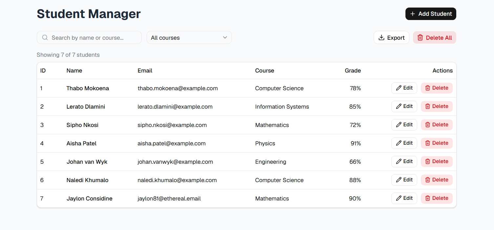
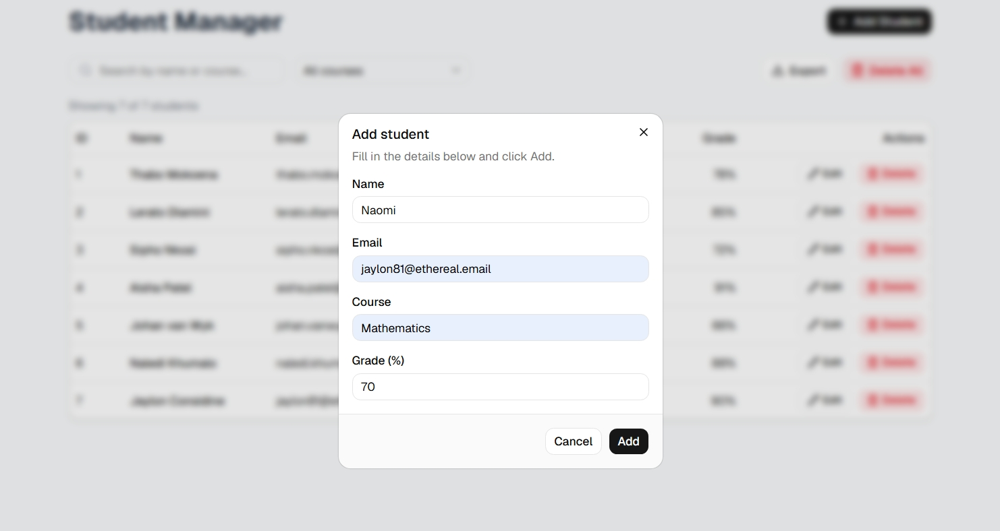
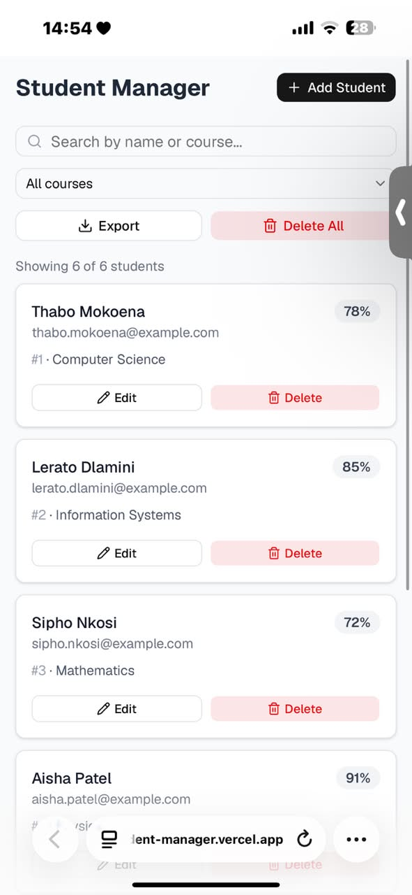

# Student Manager

A small CRUD app for managing a list of students, built with React, TypeScript, Tailwind CSS and shadcn/ui. It is a frontend-only project that runs on mock data held in React state, so there is no backend or database to set up.

## **Live demo:** [student-crud](https://crud-student-manager.vercel.app/)

## Screenshots

**Student list** with search, course filter, export and delete-all controls:


**Add** student dialog (the same form is reused for editing):


**Mobile View**:


## Features

- **Create:** add a student through a dialog form
- **Read:** view all students in a table
- **Update:** edit any student from the row's Edit button
- **Delete:** remove one student, with a confirmation step
- **Delete all:** clear the whole list, with a confirmation step
- **Search:** filter by name or course as you type
- **Filter:** narrow the table by course using a dropdown
- **Export:** download the currently visible rows as CSV or PDF

## Tech stack

| Tool                                                                                                              | Purpose                                    |
| ----------------------------------------------------------------------------------------------------------------- | ------------------------------------------ |
| [React](https://react.dev)                                                                                        | UI library                                 |
| [TypeScript](https://www.typescriptlang.org)                                                                      | Type safety                                |
| [Vite](https://vite.dev)                                                                                          | Dev server and build tool                  |
| [Tailwind CSS](https://tailwindcss.com)                                                                           | Styling                                    |
| [shadcn/ui](https://ui.shadcn.com)                                                                                | Table, dialog, select and other components |
| [lucide-react](https://lucide.dev)                                                                                | Icons                                      |
| [jsPDF](https://github.com/parallax/jsPDF) + [jspdf-autotable](https://github.com/simonbengtsson/jsPDF-AutoTable) | PDF export                                 |

## Getting started

**Prerequisite:** Node.js installed (check with `node -v`).

```bash
# 1. Clone the repository
git clone <your-repo-url>
cd student-crud

# 2. Install dependencies
npm install

# 3. Start the dev server
npm run dev
```

Then open the URL printed in the terminal (usually `http://localhost:5173`).

## Scripts

| Command           | What it does                                          |
| ----------------- | ----------------------------------------------------- |
| `npm run dev`     | Starts the development server                         |
| `npm run build`   | Type-checks and creates a production build in `dist/` |
| `npm run preview` | Serves the production build locally                   |
| `npm run lint`    | Runs ESLint                                           |

## Project structure

```
src/
├── components/
│   ├── ui/                      # shadcn/ui components (generated)
│   ├── DeleteAllDialog.tsx      # Confirmation for deleting everything
│   ├── DeleteStudentDialog.tsx  # Confirmation for deleting one student
│   ├── ExportMenu.tsx           # CSV / PDF dropdown
│   ├── StudentFilters.tsx       # Search box and course dropdown
│   ├── StudentFormDialog.tsx    # Shared form for Add and Edit
│   └── StudentTable.tsx         # The table with row actions
├── data/
│   └── students.ts              # Mock data
├── lib/
│   ├── exportStudents.ts        # CSV and PDF helpers
│   └── utils.ts                 # shadcn class-name helper
├── types/
│   └── student.ts               # Student interface
├── App.tsx                      # State and wiring for everything
├── index.css                    # Tailwind and theme variables
└── main.tsx                     # Entry point
```

## How it works

- All data lives in a single `students` state in `App.tsx`. Refreshing the page resets it to the mock data in `src/data/students.ts`.
- The displayed list (`filteredStudents`) and the course dropdown options are **derived** from state on every render rather than stored separately.
- One dialog (`StudentFormDialog`) handles both adding and editing. If a student is passed in, it edits; otherwise it creates.
- Exports use the filtered list, so the file matches what you see on screen.

## Possible improvements

- Persist data with `localStorage`
- Form validation and toast notifications
- Sorting by column and pagination
- Connect to a real API in place of the mock data
- Unit tests with Vitest and React Testing Library

## Deployment

The app builds to static files, so it can be hosted on any static host (Vercel, Netlify, GitHub Pages, Cloudflare Pages).

```bash
npm run build
```

Upload or connect the `dist/` folder. For GitHub Pages, set `base: '/your-repo-name/'` in `vite.config.ts`.

## License

Personal project, free to use for learning.
